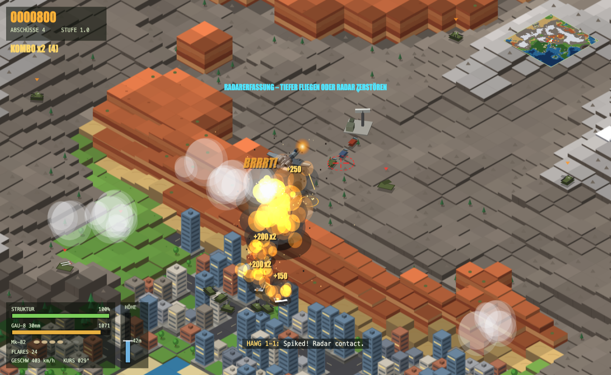
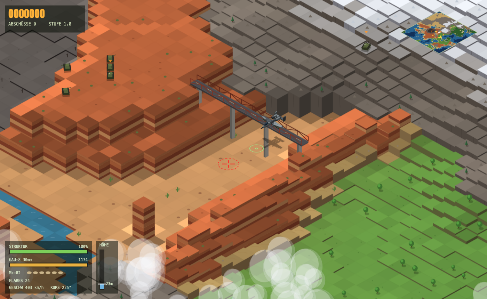
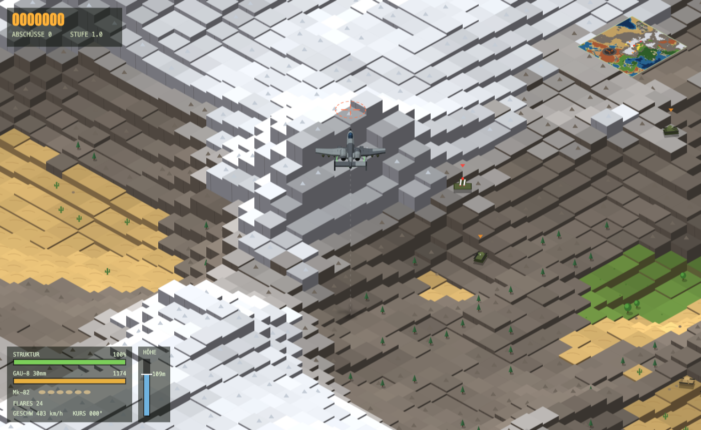
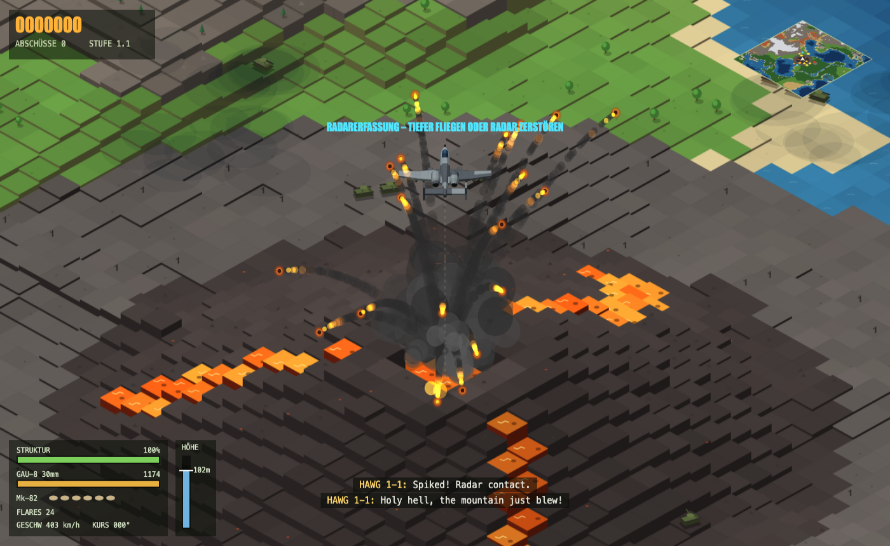
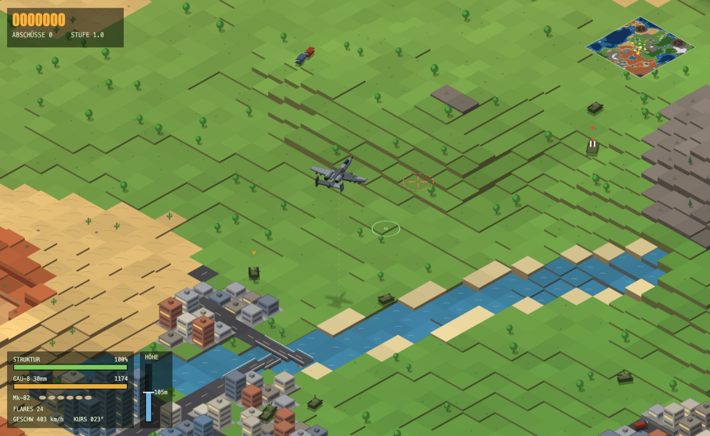
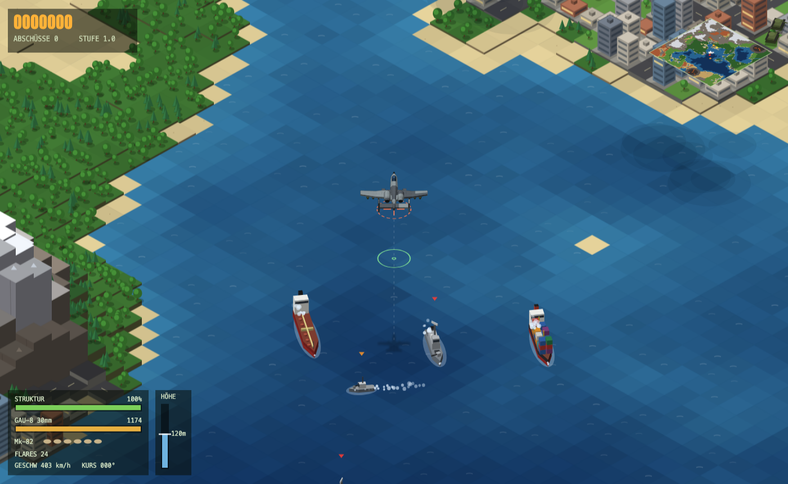

# A10 BRRRT

Isometrisches Browserspiel: Du fliegst eine **A-10 Thunderbolt II** über eine zufällig generierte, endlose Welt und bekämpfst Bodenziele mit der GAU-8-Kanone und Mk-82-Bomben, während dich Flak, Lenkraketen und gelegentlich ein Vulkan vom Himmel holen wollen.



## Starten

Keine Installation, kein Build: einfach `index.html` im Browser öffnen.

```bash
open index.html          # macOS
xdg-open index.html      # Linux
```

Läuft in aktuellen Versionen von Chrome, Edge, Firefox und Safari. Ton und Funkverkehr starten mit dem Klick auf **STARTEN**.

## Steuerung

| Taste | Aktion |
|---|---|
| ← → / A D | Steuern (Kurve mit Querneigung) |
| ↑ ↓ / W S | Steigen / Sinken |
| E / Q | Schub erhöhen / drosseln |
| Leertaste / Linksklick | GAU-8 Avenger 30 mm – *BRRRT* |
| B / Rechtsklick | Mk-82 Bombe abwerfen |
| F | Täuschkörper (Flares) |
| P / Esc | Pause |
| M | Ton und Funk an/aus |

Der grüne Kreis vor dem Flugzeug zeigt den Treffpunkt der Kanone, das rote Fadenkreuz den Einschlag der Bomben. Beide wandern mit der Flughöhe.

## Die Welt

Jeder Start erzeugt eine neue, unendlich große Welt aus Rauschfunktionen: Meer mit Inseln, Strände, Wiesen, Wälder, Wüsten, Städte mit Straßennetz und Hochhäusern, Flüsse mit Brücken, Hochgebirge mit Schneegipfeln, rote Canyonlands und aktive Vulkane.

| | |
|---|---|
|  |  |
| **Canyonlands** – geschichtete Felswände, Flüsse, Felsnadeln und hohe Stahlbrücken, unter denen man durchfliegen kann | **Hochgebirge** – Grate bis knapp 300 px Höhe, die Schneegrenze richtet sich nach der echten Höhe |
|  |  |
| **Vulkane** – Krater mit Lavasee und Lavaströmen; bei Ausbrüchen fliegen Lavabomben, die auch dich treffen | **Flüsse** – durch Grasland, Wälder und Städte, mit Land- und Straßenbrücken |

## Gegner



| Ziel | Gefahr | Punkte |
|---|---|---|
| LKW | – (lässt manchmal eine Reparaturkiste fallen) | 50 |
| Panzer | – | 100 |
| Flakpanzer | Sperrfeuer mit Vorhalt | 150 |
| SAM-Stellung | Lenkraketen | 250 |
| Radarstation | erhöht Reichweite und Feuerrate der SAMs in der Nähe | 350 |
| Treibstofflager | – (große Explosion) | 300 |
| Patrouillenboot | leichte Flak | 200 |
| Fregatte | Flak und Lenkraketen | 600 |
| Frachter / Tanker | – | 350 / 450 |
| Gebäude, Brücken | – | 25 pro Stockwerk / 100 |

Schnelle Abschussserien geben einen Kombo-Multiplikator bis ×5. Die Schwierigkeit steigt mit Spielzeit und Flugstrecke.

## Spielmechanik

- **Flughöhe ist Taktik.** Tief fliegen macht die Kanone präziser, bringt dich aber in Reichweite der Flak. Unter etwa 35 m über Grund kann dich weder Radar noch SAM erfassen. Hoch fliegen schützt vor Flak, aber nicht vor Raketen.
- **Absturz ist möglich.** Gelände, Bäume, Hochhäuser, Schiffsaufbauten, Radarmasten, Vulkanflanken und Brückenfahrbahnen sind Hindernisse. Eine Bodennähe-Warnung mit Warnton kündigt Kollisionen an.
- **Raketen** lassen sich mit Flares ablenken und mit harten Kurven ausmanövrieren.
- **Bomben aus zu geringer Höhe** beschädigen das eigene Flugzeug.
- **Munition, Bomben und Flares** laden sich langsam nach. Struktur gibt es nur über Reparaturkisten.
- **Funkverkehr auf Englisch** (Web Speech API): du als *Hawg 1-1*, dein Flügelmann *Hawg 1-2* und die Bodenleitstelle *Warhammer*. Das Spiel wählt automatisch männliche Systemstimmen. Bessere Stimmen lassen sich unter macOS bei *Bedienungshilfen → Gesprochene Inhalte → Systemstimme → Stimmen verwalten* nachladen.

## Technik

- Eine einzige Datei: `index.html` mit HTML, CSS und JavaScript, ohne Abhängigkeiten.
- Rein lokal: keine externen Ressourcen, keine Web-Fonts (nur Systemschriften wie Impact und Menlo), keine Netzwerkzugriffe. Die Sprachausgabe nutzt ausschließlich lokal installierte Stimmen; Online-Stimmen wie „Google US English“ werden übergangen. Ohne lokale englische Stimme erscheint der Funk nur als Untertitel.
- Canvas 2D in isometrischer Projektion. Das Gelände wird in Chunks von 12×12 Kacheln vorgerendert und zwischengespeichert. Zerstörungen zeichnen nur den betroffenen Chunk neu.
- Die Welt entsteht aus Value-Noise mit fBm, Grat-Rauschen für Gebirge und Rauschkanälen für Flüsse und Canyons. Vulkane werden pro Rasterzelle platziert.
- Die A-10 ist ein Low-Poly-3D-Modell mit rund 660 beleuchteten Flächen, Zwei-Ton-Tarnung (FS 36118 / FS 26270) und falschem Cockpit. Sie neigt sich in Kurven und beim Steigen. Ihre Darstellungsgröße hängt von der Flughöhe ab.
- Schiffe und Radarstationen bestehen aus nach Tiefe sortierten Prismen.
- Sound wird vollständig mit der Web Audio API erzeugt (GAU-8-Knattern, Triebwerk, Explosionen, Warntöne), es gibt keine Audiodateien.

## Screenshots neu erzeugen

Das Spiel hat einen Screenshot-Modus: `index.html#shot=<szene>` baut eine feste Szene mit festem Seed auf und friert das Bild ein. Szenen: `title`, `combat`, `canyon`, `mountains`, `volcano`, `city`, `sea`.

```bash
bash tools/screenshots.sh           # alle Szenen nach docs/screenshots/
bash tools/screenshots.sh volcano   # nur eine Szene
```

Das Skript nutzt Google Chrome im Headless-Modus. Mit `CHROME=/pfad/zum/browser` lässt sich ein anderer Chromium-Browser verwenden.

## Projektstruktur

```
index.html               das komplette Spiel
tools/screenshots.sh     erzeugt die README-Screenshots
docs/screenshots/        Screenshots für dieses README
```
